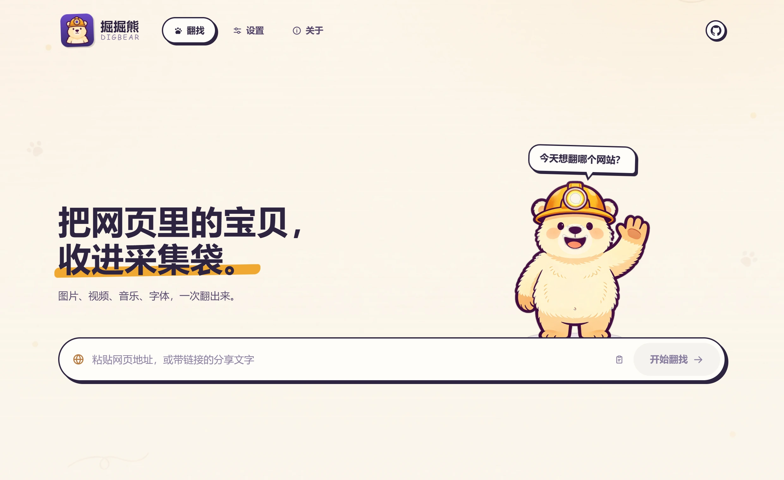

<p align="center">
  
</p>

<p align="center">
  
  
  
  
</p>

## 它是什么

**掘掘熊（DigBear）是一个 Windows 小工具：粘贴一个网址，它帮你把那个页面里的图片、视频、音乐和字体全都找出来，你挑完再一起存到本地。**

不用懂技术，不用装插件，不用注册账号。装好之后双击打开，把网址粘进去就行。

<p align="center">
  
</p>

## 为什么值得一用

- **一个网址，四类素材一起找** —— 图片、视频、音乐、字体同时扫出来，不用来回换工具。
- **画质往高处挑** —— 同一张图有多个分辨率时优先给最大的；视频会尽量取最高画质那一档。
- **挑完再存** —— 结果先列成清单，按类型筛选、看大图预览，勾好了点一下批量下载。
- **需要登录的站点也能用** —— 在内置窗口里登录一次即可；登录状态只存在你自己的电脑上。
- **不白等** —— 下载断了会自己接着来，失败会重试，已经下过的文件下次自动跳过。
- **数据不出门** —— 只读取网页，不上传任何素材，没有账号、没有遥测。

## 下载安装

到 **[Releases](https://github.com/odin1024/DigBear/releases/latest)** 页面下载：

| 文件 | 适合谁 |
| --- | --- |
| `DigBear_0.4.0_x64-setup.exe` | **推荐**，双击安装，个人用户用这个 |
| `DigBear_0.4.0_x64_zh-CN.msi` | 需要批量部署的（企业 / 机房） |
| `DigBear_extension_v0.4.0.zip` | 可选：浏览器扩展，一键把当前网页交给掘掘熊 |

**三步就能用起来：**

1. 下载 `setup.exe`，双击运行
2. 如果 Windows 弹「已保护你的电脑」，点 **更多信息 → 仍要运行**（应用没有购买代码签名证书，不是病毒）
3. 打开掘掘熊，粘贴网址，点「开始翻找」→ 挑素材 → 下载

> 系统要求：Windows 10（1809 及以上）或 Windows 11，64 位。
> Win11 自带所需运行环境；Win10 如果提示缺少 WebView2，点一下安装即可。
> 下载前可以用附带的 `SHA256SUMS` 校验文件完整性。

## 用起来大概是这样

1. **粘贴网址** —— 支持直接粘贴剪贴板里的链接，也可以一次排队多个网址。
2. **等它翻找** —— 页面在后台静默打开扫描，界面会显示进度。
3. **挑** —— 按图片 / 视频 / 音乐 / 字体分类查看，可只看大图，也可一键全收。
4. **存** —— 选好保存目录，批量下载；支持自定义文件名规则、按类型分文件夹。

设置里还有：深色主题、下载失败自动重试、下载前检查磁盘空间、历史记录与收藏。

## 会碰到的小问题

- 页面里那些看不见的**追踪像素**（没有扩展名的小图）也会被当成图片列出来，手动排除一下即可。
- **网页里正在边下边播的视频流**（`blob:` 这类）暂时抓不到，需要后续版本支持。
- 网页里**手动改了背景图**、但代码没在页面源码里体现的，可能扫不到。
- 资源特别多的页面（1000+）会需要多等一会儿。

## 反馈与建议

遇到问题、有好想法，或者想提一条建议？

<p align="center">
  
</p>

- **公众号**：微信扫一扫关注后直接留言，反馈会更快看到
- **GitHub Issue**：功能建议、缺陷报告都欢迎，[点这里提交](https://github.com/odin1024/DigBear/issues)
- 应用内「关于」页也能扫到同一个二维码

> 反馈时如果能带上目标网址和复现步骤，会省下很多来回沟通。

## 许可与致谢

本项目使用 **MIT 许可证**，可自由使用、修改与分发。
致敬上游开源项目 [Crawl Bear（超级爬爬熊）](https://github.com/xw-meow/crawl-bear) 与作者 [xw-meow](https://github.com/xw-meow)。
详细许可见 [LICENSE](./LICENSE) 与 [NOTICE.md](./NOTICE.md)。

---

<details>
<summary><b>给开发者：从源码构建</b></summary>

需要 Windows + Node.js 20+、pnpm 12、Rust stable、Microsoft C++ Build Tools。

```powershell
pnpm install
pnpm test:rust          # 单元测试
powershell -File scripts/build_windows.ps1   # 产出 NSIS + MSI
```

文档：[更新日志](./CHANGELOG.md) · [开发规范](./docs/CONTRIBUTING.md) · [发布流程](./docs/RELEASES.md) · [路线图](./docs/ROADMAP.md) · [移植记录](./PORTING.md)

</details>
